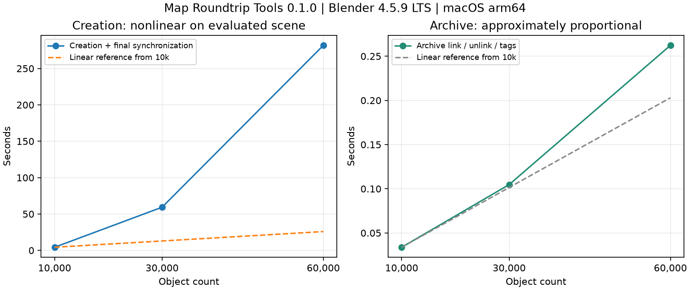

# Map Roundtrip 検証報告

対象version: Map Roundtrip Tools **0.7.0**（Replaceの性能実測は0.1.0。0.1.1はUI・ヒントを更新。0.3.0の実測は末尾。0.4.0はidの扱い、0.5.0はCollection階層の復元のみ追加） / Unreal Bridge Tools **2.3.3**（性能測定時は2.3.0） / Taiyo Extension Manager **1.0.17**

検証日: 2026-11-11（日本時間）。macOS arm64、Blender **4.5.9 LTS** / **5.2.2 LTS**。外部のHoudini／Unrealは実行対象外です。

## 結果

配置・FBXの統合回帰と実UIのESC復元は合格しました。**6万件での生成時間の線形性、および最大0.5秒のUI応答目標は未達です。** Mesh共有のリンク複製方式は維持しています。

## 性能（秒）

| 件数 | CSV Selected | CSV Collection | plan | 生成＋最終同期 | Archive | Replace全体 | 最長単一step |
|---:|---:|---:|---:|---:|---:|---:|---:|
| 10,000 | 0.268 | 0.243 | 0.037 | 4.314 | 0.034 | 4.416 | 0.728 |
| 30,000 | 0.829 | 0.719 | 0.142 | 59.327 | 0.105 | 59.645 | 2.139 |
| 60,000 | 1.649 | 1.501 | 0.278 | 281.792 | 0.262 | 282.516 | 3.878 |

10万点・全4ゾーン（5個のCube）のnumpy判定: **0.01374秒**（点の取得・選択適用を除く）。planは6万行でも3秒未満です。CSV Selectedは同一シーンのCollectionより約10%遅く、厳密な「同等以上」の目標は未達です。既存UBT回帰の別シーンでは6万行2.731秒でした。

生成は1万→3万→6万で約4.31→59.33→281.79秒となり、線形ではありません。Archiveは約0.034→0.105→0.262秒で、二次関数的な増加は見られませんでした。生成値には最後の依存グラフ同期が含まれます。単一stepはgeneratorのyield間隔で、timer全体の上限を保証する値ではありません。最長stepが0.5秒を超えるため、大規模処理の応答目標は満たせません。

### 原因切り分けと対策

- 既定の新規Collectionはシーン未リンク状態で充填します。既存Collectionは変更せず再利用します。
- 同名Objectの自動連番探索を避ける名前集合・連番キャッシュを追加しました。
- 切り分け用の1万Object試験では、評価済みシーンでObject.newが約5.29秒、linkが約0.022秒でした。未リンクCollectionでもObject.new約13.06秒・link約0.025秒で、Collection未リンク化だけでは解消しませんでした。Object.newとlinkを別フェーズに分ける試験もObject.new約5.26秒で解消しませんでした。
- 既存Collectionへの処理件数調整は、時間予算内で最大8192ステップまで自動調整します。最終同期や単一FBXオペレーターは分割できません。
- 計測には複数Blenderの一部実行時間帯が重なっています。再現用スクリプトと生JSONを同梱し、絶対時間は参考値とします。非線形傾向は対策前後の両方で再現しました。

## 仕様書§9.2 受け入れ16項目

| # | 結果 | 確認内容・制約 |
|---:|---|---|
| 1 | 合格 | 回転・スケール付きCube、複数領域、重複時のZONE_A優先を確認。 |
| 2 | 合格 | Selectedの行数・12列・名前・ワールドTransformを確認。6万行出力も実行。 |
| 3 | 合格 | 正常終了時だけタグ付与。ESC・エラー・一時出力再試行では中途タグなし。 |
| 4 | 合格 | 選択ゼロのエラーとファイル未作成を確認。 |
| 5 | 合格 | Previewの旧／新件数と非変更を確認。6万行planも一致。 |
| 6 | 合格 | Archive除外・所属移動・タグ変更・位置回転スケール・Mesh共有を確認。 |
| 7 | 未検証 | TransformとMesh共有の自動比較は合格。人による画面の目視比較は未実施。 |
| 8 | 合格 | 同じゾーンの再実行で現在タグ総数が一定、過去配置が追加Archive。 |
| 9 | 合格 | 作成中・Archive中・タグ変更中のESC／例外を検証。所属・タグ・一時hide・選択を復元。実UIは2000件。 |
| 10 | 合格 | Delete後の現在タグ数・共有Meshを確認。batch_removeを使用。 |
| 11 | 合格 | 未解決名のスキップ・集計と先頭5件表示を実装。 |
| 12 | 合格 | 未知colnameのMap直下Collection作成を確認。 |
| 13 | 合格 | Blender製FBX代用でSKIP／UPDATE／Material再利用を確認。UPDATE途中の中断でも旧Mesh参照へ復元。 |
| 14 | 合格 | Per Objectの12ファイル、サニタイズ、既存パスの連番、Combined、選択・active維持を確認。 |
| 15 | 合格 | LINEAR既定とカラー属性を含むFBX往復を確認。Unreal内の見た目は未検証。 |
| 16 | 不合格 | 6万件のCSV・plan・生成・Archiveを計測。生成線形性と0.5秒目標は未達。全16操作の6万件実UI再実行は未実施。 |

## 要検証3件

1. **FBX importer**: 4.5.9・5.2.2とも`wm.fbx_import`。旧Python版へのfallbackは模擬的なAPI欠落で回帰検証しました。
2. **temp_override**: 採用。複数選択中に1個だけ出力したFBXを再取り込みし、Mesh Objectが1個だけになることを両バージョンで確認しました。
3. **link線形性**: link単体より評価済みシーンでのObject作成が支配的でした。新規Collectionの未リンク充填と時間予算調整を採用しましたが、生成の非線形性は残っています。

## 変更・追加ファイル

- UBT: `__init__.py`、`preset_utils.py`、`blender_manifest.toml`、`README.md`、`Unreal_Bridge_Tools_使用書.md`を更新。`constants.py`、`zones.py`を追加。
- MRT: `__init__.py`、`constants.py`、`props.py`、`presets.py`、`chunked.py`、`fbx_export.py`、`mesh_import.py`、`placement.py`、`ui.py`、`blender_manifest.toml`、`README.md`、本報告、ベンチJSON／PNG、`tools/bench_make_scene.py`を追加。
- リポジトリ: `tools/test_map_roundtrip_tools.py`、`tools/benchmark_map_roundtrip_tools.py`、`tools/ui_test_map_roundtrip_tools.py`を追加。Extension Managerの本体／manifest／README、ビルド対象、README一覧、AGENTS、配布ZIP／indexを更新。

## 既定値と公開範囲

仕様書§11を採用しました。追加の実装上の既定は、非有限数値を不正行としてスキップすること、特異なゾーン変換をエラーにすること、復元中の再中断を抑止することです。FBX既定値やCSV列は変更していません。

配布indexは既存27件にMRTを加えた**28件**です。Object Groupsの公開済み内容は保持し、今回のcommitでは変更しません。Manager 1.0.17は公開済みの別名を維持し、MRT検索語と説明を追加します。

## 0.1.1 / UBT 2.3.2のUI更新

SceneへのZone登録・既存Empty登録・解除・保存復元・日本語ホバーヒントは tools/test_unreal_bridge_zone_registry.py でBlender 4.5.9 / 5.2.2にて確認。標準FBX画面の実UIは tools/ui_test_map_roundtrip_native_fbx.py で、標準ExporterのID、PRESET対応、選択MeshとLinearカラー初期値、キャンセル時の非出力を確認しました。補助機能の個別FBX出力と配置・復元の既存回帰も合格しました。手順は[詳細使用書](WORKFLOW_JA.md)にまとめています。

## 0.2.0の担当整理

ゾーン管理・範囲内Mesh選択・ゾーンCSV出力をMRTへ移しました。UBT 2.3.3は2.2.20相当の元の機能です。本報告の旧UBT Selected/Zone UIの記述と性能表は過去版の記録です。現行手順はWORKFLOW_JA.mdを参照してください。新しい回帰はtools/test_map_roundtrip_tools.py、test_map_roundtrip_zones.py、test_map_roundtrip_zone_registry.py、test_map_roundtrip_zone_migration.pyで検証します。

0.2.0の選択CSVはBlender 4.5.9で6万件0.787秒、最大tick0.085秒でした。MRT単独のゾーン管理・CSV・配置・FBX、旧ゾーンのAdd/Subtract/登録状態、個別/全ゾーンのEmpty選択を4.5.9/5.2.2で回帰確認します。

## 0.3.0の追加（Add Selected Objects・ゾーン範囲CSV・Zones UI再構成）

検証日: 2026-11-12（日本時間）。macOS arm64（Apple M1 Pro）、Blender **4.5.9 LTS**のみ。Blender 5.x・Linux・Houdini・Unrealは未検証です。

### 実測（6万Object）

2mの格子に並べた60,025個のMesh（共有Mesh）のうち、左半分の29,890個を選択して`tools/benchmark_map_roundtrip_add_objects.py`で測定しました。`Merge Distance`は5 m。シーン生成は11.78秒です。

| 操作 | 全体（秒） | 最長tick（秒） | 結果 |
|---|---:|---:|---|
| Add Selected Objects | 3.50（`bpy.ops`呼び出し込みで4.95） | 0.335 | 29,890個を4,802個のEmptyへ。分離不能0 |
| Select Meshes In Zone（確認用） | 6.30 | - | ゾーンの中身が選択と**完全一致**（欠落0・余分0） |
| Export Zone CSV | 6.48 | 0.473 | 29,890行。選択は使わない |

- 「全体」はオペレーターの状態表示の値です。括弧内の差は`bpy.ops`呼び出しとUndo保存の時間です。最長tickはタイマー1回分の最大実行時間（目標0.5秒以内）です。
- 1つの箱にまとめた数は、格子と`Merge Distance`に依存します。実際のシーンでは変わります。
- 6万件のReplace（配置生成）の性能は0.1.0から変わっていません（上表）。

### 実測で見つけて直した不具合

- **座標が大きいと箱の端のMeshが範囲から落ちる**: Blenderは行列をfloat32で持ち、逆行列の平行移動項に誤差が出ます。座標約490で、29,890個中4,324個が欠落しました。箱の余白を座標の大きさに比例させて解消し、座標490・5,000・50,000の回帰テストを追加しました（余白を0にすると490でテストが失敗します）。
- **最後の検証が1つのtickに固まっていた**（最長2.8秒）: 箱と点の比較を分割してyieldし、最長tickを0.335秒にしました。

### 実UI（Blender 4.5.9、`--enable-event-simulate`）

6,000個のMeshのうち3,000個を選択して確認しました。いずれも合格です。

- 作成の途中でESCを物理イベントで送ると、作ったEmptyをすべて取り消す。選択とMeshは変わらず、`Cancelled`と表示される。
- 通常完了後、ゾーンの中身がちょうど選択したMeshと一致する。評価済み（描画用）のEmptyも取得できる。
- Undoで追加したEmptyが消え、Redoで戻る。Meshは変わらない。

3Dビューのスクリーンショットでサイドバーを確認し、Zonesパネルが最上部に出ること、折りたたみ、`Merge Distance`、`Export ZONE_A.csv`のボタン名、日本語のホバーヒントが出ることを確認しました。

### 制約・未検証

- 1つのObjectだけのEmptyは範囲が約2 mmで、3Dビューでは点にしか見えません（`Zone Empties`の一覧から選択できます）。
- `Add Selected Objects`は未選択Meshと原点がほぼ同じObject（約2e-5以内）を分離できず、Emptyを作らずに件数で知らせます。
- 既存のSubtract範囲の判定（`removed by Subtract`）は箱の数が多いと時間がかかり、その区間は分割されません。
- 本人の制作Scene、Blender 4.5.10・5.x、Linuxでの確認、全16操作の6万件実UI再実行は未実施です。

## 0.4.0の追加（CSVのid判定）

検証日: 2026-11-13（日本時間）。macOS arm64、Blender **4.5.9 LTS**のみ。Houdini・Unrealは未検証です。

- Export Zone CSVが各行の`id`をMeshの`ub_csv_id`へ保存し、Houdiniから戻すPlacement CSVで`id`を判定します（`-1`＝追加Mesh、不明なid＝使用しない、`ub_csv_id`が無いゾーン＝判定なし）。
- 回帰：`tools/test_map_roundtrip_csv_id.py`（10項目）、既存の`test_map_roundtrip_tools.py` `_zones.py` `_zone_csv.py` `_add_objects.py` `_ui_layout.py` `_zone_registry.py` `_zone_migration.py` `_addon_lifecycle.py`がすべて合格しました。
- 性能は測っていません。追加した処理は行ごとの整数比較と、書き出し時のプロパティ1つの書き込みだけです。6万件での実測は未実施です。
- 取り込みパネルの実画面表示は未確認です（UIレイアウトテストのみ）。

## 0.5.0の追加（colnameの階層パス）

検証日: 2026-11-13（日本時間）。macOS arm64、Blender **4.5.9 LTS**のみ。Houdini・Unrealは未検証です。

- Export Zone CSVの`colname`が、Mapからの階層パス（例 `Area1/Rocks`）になり、Replace Zoneが`Map`の下に無いCollectionを入れ子のまま作ります。名前だけの旧CSVは、従来どおり名前で探します。
- 回帰：`tools/test_map_roundtrip_colname_path.py`（7項目：Map基準／Map未指定／`/`を含む名前／解決（既存・新規・途中の階層・旧名・`//`・先頭がMapの名前）／階層の作成と配置／名前の衝突の警告／ESC・例外でのロールバック／書き出し→復元）に加え、既存の9本がすべて合格しました。
- 6万Objectの書き出し（`tools/benchmark_map_roundtrip_add_objects.py`）：全体6.5〜6.96秒、最長tick 0.477〜0.510秒（0.4.0までは6.48秒、0.473秒）。測定のたびにばらつくため、目標の0.5秒前後です。colnameの計算中は4096件ごとに制御を返します。
- 数千個のCollectionを持つシーンでの時間は、測っていません。
- Mapの外にあったCollectionは`Map`の下に新しく作られ、元の場所へは戻りません。名前が既に使われていると`.001`が付きます（警告あり）。

## 0.5.1の追加（使用書のみ）

コードの動作は0.5.0と同じです。「Houdiniで変えた内容の扱い」を使用書へ追記し、その動作（移動＝新しい値で作り直し、削除＝旧Objectだけ退避、`id=-1`＋`colname`の階層パス＝入れ子のCollectionへ配置、不明idは未使用）を`tools/test_map_roundtrip_colname_path.py`の項目として追加しました。Blender 4.5.9で合格しました。Houdini実機は未検証です。

## 0.6.0の追加（EmptyをMeshのCollectionへ）

検証日: 2026-11-13（日本時間）。macOS arm64、Blender **4.5.9 LTS**のみ。

- Add Selected Objectsで作るEmptyを、シーンのルートではなく、元のMeshがいるCollectionへ入れます。まとめたEmptyは多数決（同数はシーンで先のCollection）で、複数のCollectionにまたがった数を`mixed-collection empties N`として出します。
- 回帰：`tools/test_map_roundtrip_empty_collection.py`（各Collection・ネスト・ルート／多数決と報告／同数／複数所属・シーン外Collection／ESCでの取り消し）に加え、既存の10本が合格しました。実UI（`tools/ui_test_map_roundtrip_add_objects.py`：ESC取り消し・完了・Undo・Redo・描画）も合格しました。
- 6万Object（すべてシーンのルート）の測定：Add Selected Objects 4.75〜4.84秒、最長tick 0.326〜0.329秒（0.3.0の実測は4.95秒、0.335秒）。ゾーンの中身は選択と完全一致です。Collectionが多数あるシーンでの時間は測っていません。
- 読み取り専用（リンクされた）Collectionの実機での挙動は、未確認です。編集できないときの退避先をシーンの最上位にしてあります。

## 0.7.0の追加（差分更新・復元・エラー詳細・追加Meshの置き場・Helper）

検証日: 2026-11-13（日本時間）。macOS arm64（Apple M1 Pro）、Blender **4.5.9 LTS**のみ。Houdini・Unrealは未検証です。

- **差分更新**: Replace Zoneは`ub_csv_id`で元のObjectと対応づけ、変わっていないObjectには触りません。動いたObjectはその場で更新、削除されたObjectは`_Replaced_ZONE_A`へ元の階層（ミラーCollection）のまま退避、新しいObjectだけを作ります。`Delete`は廃止しました。
- **復元**: Restore Original Map / Re-apply Imported Mapで、最初のReplace Zoneの前と取り込み後を切り替えます。取り込み後のObjectの手動編集は保たれます。
- **追加Mesh**: `New Meshes To`で取り込み先を選び、`Placement CSV`の`colname`の階層をミラーCollectionとして再現します。`colname`が複数ある場合は警告します。
- **エラー詳細**: CSVの行・列・値・理由を出します。パネルに最初の5件、全件はTextエディターの`MRT Placement Report`に書きます。
- **Helper**: Library/FromHoudiniのObjectがMapでどう使われているか（使用数・Collection・ゾーン）を調べ、選択できます。
- 回帰（すべて合格）: `tools/test_map_roundtrip_restore.py`（差分・復元・再適用・2回目のReplace・ESC・選択/非表示の保持・Importパネル・CSVの問題・ファイル全体の問題）、`test_map_roundtrip_mesh_import_paths.py`、`test_map_roundtrip_helper.py`、`test_map_roundtrip_tools.py`（Replace・ロールバック）、`_csv_id.py`、`_colname_path.py`、`_zones.py` `_zone_csv.py` `_add_objects.py` `_empty_collection.py` `_ui_layout.py` `_zone_registry.py` `_zone_migration.py` `_addon_lifecycle.py`。実UI（`tools/ui_test_map_roundtrip_tools.py`）では、物理ESCによる作成中・更新中の取り消し、Replace、Restore、Re-applyが合格しました。

### 6万Objectの実測（`tools/benchmark_map_roundtrip_diff.py`）

60,025個のMesh（Add Selected Objectsでゾーン化→Export Zone CSV）を、Houdiniから次のように返した想定です。変更なし30,012個、動いた20,008個（うち半数は別Collectionへ）、削除10,005個、新規10,000個。

| 操作 | 全体（秒） | 最長の分割できない1ステップ（秒） |
|---|---:|---:|
| Preview Placement | 0.55 | 0.05 |
| Replace Zone | 11.2〜11.3 | 2.2〜2.3（最後の依存グラフ同期） |
| Restore Original Map | 3.3〜3.6 | 2.0〜2.2（同上） |
| Re-apply Imported Map | 3.3〜3.4 | 2.0（同上） |

- Replace Zoneの内訳: 新しいObjectの作成7.7秒、CSVの計画0.56秒、移動0.4秒、退避0.2秒、最後の同期2.3秒。
- 0.6.0までの全作り直しは、6万件で約282.5秒でした（0.1.0の実測）。同じ6万件でも、変更の少ない戻りなら大幅に短くなります。変更が6万件すべてなら、作成の非線形性は残ります。
- **最後の同期（約2秒）は分割できず**、UIの応答目標（0.5秒）は、この1回分だけ超えます。
- 開発中に、動かしたObjectの選択・非表示を戻すループが68秒（2万件）かかる問題を見つけました。Collectionへの`link`を`unlink`より先に行うと、Base（選択・非表示の状態）が失われないため、そのループを無くしました（`test_selection_and_hide_flags_survive`で確認）。
- 未測定: 数千個のCollectionを持つシーン、Helperの走査時間、Blender 5.x、Linux。
